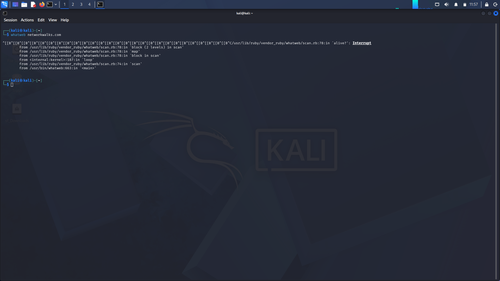
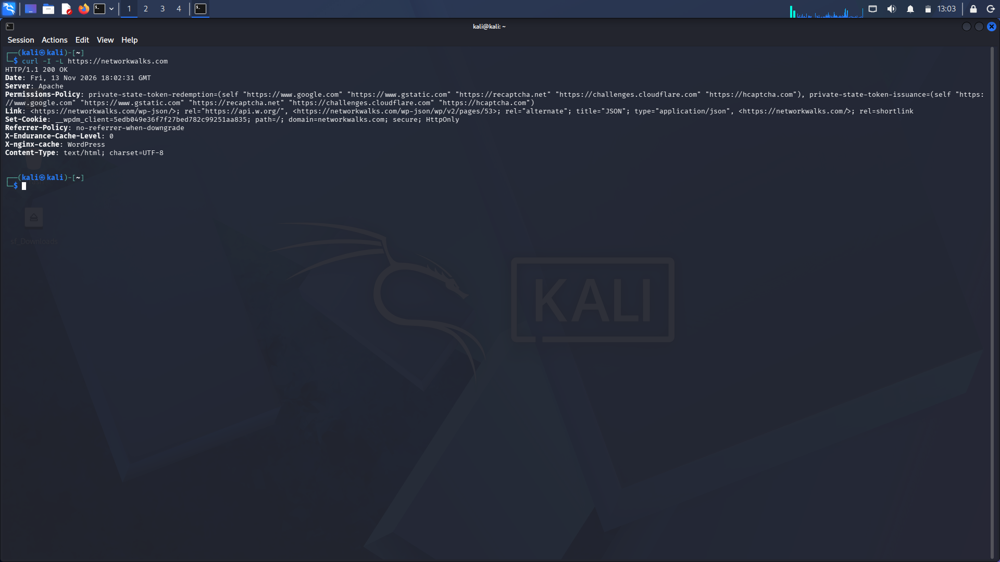
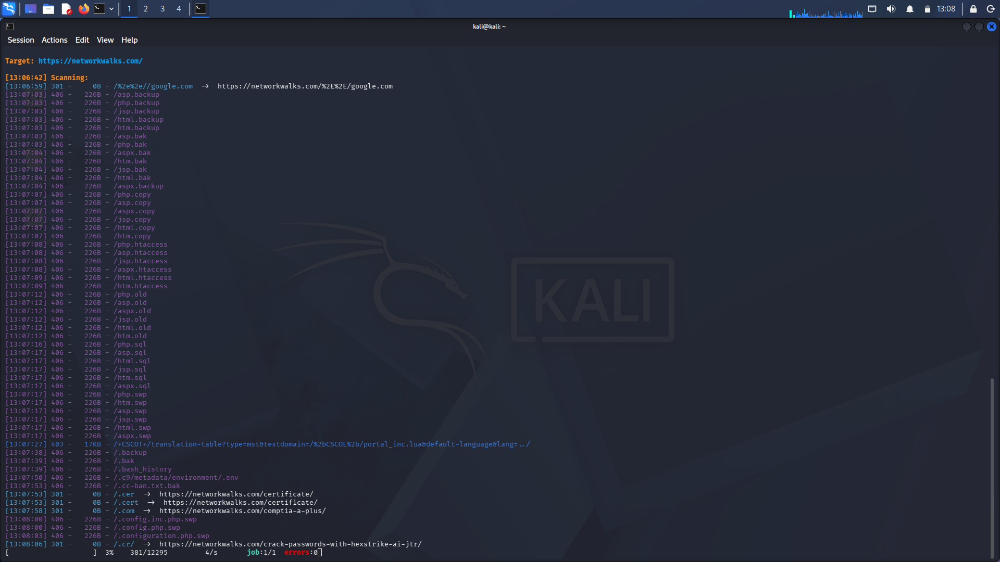

# 🛡️ Footprinting & Network Scanning — Architecture

> **Repository:** [`phanindrababusiga-cpu/footprinting-network-scanning`](https://github.com/phanindrababusiga-cpu/footprinting-network-scanning)
> **Author:** Waqas Karim CCIE — Cybersecurity Professional (Batch B082, Networkwalks)
> **Phase:** Week 2 — Penetration Testing Internship
> **Scope:** Authorized reconnaissance & network discovery (no exploitation performed)

---

## 📐 Architecture Overview

This project implements a **two‑phase offensive security workflow** that mirrors the
standard penetration‑testing kill‑chain: passive & active **footprinting** of an external
target, followed by **network scanning** of an internal LAN. The two phases run on
different operating systems (Kali Linux for recon, Windows for scanning) and target
different network layers, giving a complete picture of both the **perimeter attack surface**
and the **internal host topology**.

```
                ┌─────────────────────────────────────────────────────────┐
                │                  ATTACKER WORKSTATION                  │
                │                                                       │
                │   ┌──────────────────────┐   ┌──────────────────────┐  │
                │   │   KALI LINUX 2026.3   │   │   WINDOWS HOST       │  │
                │   │   (VirtualBox VM)    │   │   (Physical)          │  │
                │   │                      │   │                      │  │
                │   │  Phase 1 — Recon     │   │  Phase 2 — Scanning  │  │
                │   │  • whatweb           │   │  • Zenmap / Nmap GUI │  │
                │   │  • curl -I           │   │  • Topology export   │  │
                │   │  • dirsearch         │   │  • Host discovery    │  │
                │   │  • whois / nslookup  │   │                      │  │
                │   │  • dnsrecon / wafw00f│   │                      │  │
                │   └──────────┬───────────┘   └──────────┬───────────┘  │
                └──────────────┼─────────────────────────────┼─────────────┘
                               │                             │
                  ═════════════╪═════════════════════════════╪════════════
                   INTERNET    │                             │   LAN
                  ═════════════╪═════════════════════════════╪════════════
                               ▼                             ▼
                ┌──────────────────────────┐     ┌──────────────────────────┐
                │   EXTERNAL TARGET        │     │   INTERNAL LAN           │
                │   networkwalks.com       │     │   192.168.182.0/24       │
                │                          │     │                          │
                │  nginx-cache → Apache    │     │  .1   Windows host       │
                │  WordPress + WPDM plugin │     │       (msrpc/netbios/smb) │
                │  ModSecurity WAF         │     │  .254 VMware gateway     │
                │  Hostgator shared hosting│     │       (filtered ports)   │
                └──────────────────────────┘     └──────────────────────────┘
```

---

## 🧩 Components

### 1️⃣ Phase 1 — Footprinting & Reconnaissance (Kali Linux)

The recon phase runs from a **Kali Linux 2026.3 VM inside VirtualBox** and targets the
external domain `networkwalks.com`. It uses purpose‑specific tools, each addressing
a different layer of the OSI/web stack:

| Layer | Tool | Purpose | Output Captured |
|-------|------|---------|-----------------|
| Domain registry | `whois` | Registrar, creation/expiry dates, lock flags | GoDaddy registrar, created 2019‑11‑06, expires 2027‑11‑06 |
| DNS resolution | `nslookup` | A record → IP | `192.232.216.135` |
| DNS enumeration | `dnsrecon` | NS / MX / SOA / TXT‑SPF / SRV | `ns6135/ns6136.hostgator.com`, BIND 9.16.23‑RH, SPF `~all`, no DNSSEC |
| Web fingerprint | `whatweb` | Server, CMS, plugins, JS libs | Apache, WordPress 7.1.4, WPDM 3.3.76, jQuery 3.7.1 |
| HTTP headers | `curl -I` | Response headers & cache layer | HTTP/1.1 200, Apache, nginx-cache, WP REST API, WPDM cookie |
| WAF detection | `wafw00f` | Identify upstream WAF | ModSecurity (SpiderLabs) |
| Directory brute | `dirsearch` | Hidden paths & backup files | 301 redirects to legit pages; 406 on `.bak/.old/.swp` probes |

**Recon data flow:**

```
networkwalks.com
      │
      ├─► whois ──────► WHOIS/RDAP database ──► registrar + dates
      ├─► nslookup ───► DNS resolver ─────────► A record (IP)
      ├─► dnsrecon ───► authoritative NS ─────► full DNS record set
      ├─► whatweb ────► HTTP GET / ───────────► tech stack fingerprint
      ├─► curl -I ────► HTTP HEAD ────────────► headers + cache + cookies
      ├─► wafw00f ────► HTTP probe ───────────► WAF signature match
      └─► dirsearch ──► wordlist 12,295 paths ► 200/301/403/406 map
```

#### 🔍 WhatWeb — Web Technology Fingerprinting

WhatWeb identifies the CMS, web server, JavaScript libraries and plugins running on
the target. In this run the scan was launched against `networkwalks.com` from Kali's
terminal and then interrupted (`Ctrl+C`), producing the Ruby backtrace shown below.
The fact that the request blocked in the `alive?` check itself is a recon signal — it
indicates the target's edge responds slowly or drops probe traffic.



#### 🌐 curl -I — HTTP Response Headers

Fetching only the headers reveals the full edge stack: `HTTP/1.1 200 OK`, an `Apache`
origin behind an `nginx-cache` layer, the WordPress REST API exposed at `/wp-json/`,
and a `_wpdm_client` cookie confirming the **WordPress Download Manager** plugin. Several
hardening headers (HSTS, CSP, X‑Frame‑Options, X‑Content‑Type‑Options) are absent.



#### 📂 dirsearch — Directory & Backup‑File Brute Force

`dirsearch` walked a ~12,295‑entry wordlist against `https://networkwalks.com/` at
roughly 4 requests/second. The visible output shows 301 redirects to legitimate site
pages (`.cer`, `.cert`, `.com`, `.cr`), a 403 on a known Cisco `CSCOE/portal_inc.lua`
probe, and a block of 406 responses for backup/config file extensions (`.bak`, `.old`,
`.swp`, `.sql`, `.copy`, `.htaccess` variants) — confirming the server rejects those
suffixes rather than serving them.



> WHOIS, nslookup, dnsrecon and wafw00f screenshots are stored in the repo root and are
> documented in the accompanying `Week2_Pentest_Report_Footprinting_Scanning 2.pdf`.

### 2️⃣ Phase 2 — Network Scanning (Windows + Zenmap)

The scanning phase runs on a **Windows host** using **Zenmap** (Nmap's GUI, version 7.99)
against the local subnet `192.168.182.0/24`.

```
Quick scan profile
   nmap -T4 -F 192.168.182.0/24
       │
       ├─► Host discovery  (ARP / ICMP)
       ├─► Top-100 TCP port scan per host
       └─► Topology graph  (ring view, exportable to PNG)

Discovered hosts:
   • 192.168.182.1   →  Windows host   (135/msrpc, 139/netbios-ssn, 445/smb OPEN)
   • 192.168.182.254 →  VMware gateway (100 filtered ports, MAC 00:50:56:ED:F8:F7)
```

#### 🖥️ Zenmap — Quick Scan of 192.168.182.0/24

The Quick scan profile (`nmap -T4 -F 192.168.182.0/24`) discovered two live hosts in
18.83 seconds. Host `192.168.182.1` is a Windows machine exposing the classic
NetBIOS/SMB trio (135/msrpc, 139/netbios-ssn, 445/microsoft-ds), while `192.168.182.254`
is a VMware gateway with all 100 probed ports filtered (no response — firewall dropping
packets). Its MAC `00:50:56:ED:F8:F7` confirms a VMware virtual adapter.


#### ⚠️ Zenmap — Malformed Target (Intense scan attempt)

An Intense scan was attempted against `192.168.182` (a malformed address — only three
octets). Nmap 7.99 immediately reported `Failed to resolve "192.168.182".` and scanned
zero hosts. This screenshot is included as an honest record of a misfire that was
corrected by switching to the `/24` Quick scan above.


#### 🗺️ Zenmap — Topology Export

The Topology tab visualises discovered hosts as nodes on a ring around `localhost`
(the scanning machine). Green = host up; yellow = intermediate/uncertain state. The
graph was exported as a PNG through Zenmap's *Save Topology* dialog (screenshots of the
export dialog against the Desktop and the `C:\Program Files (x86)\Nmap` folder are
included below as evidence of the workflow).

<p float="left">
  
  
  
  
</p>

---

## 🗂️ Repository Structure

```
footprinting-network-scanning/
├── README.md                                       # Full pentest report (8 sections)
├── Week2_Pentest_Report_Footprinting_Scanning 2.pdf
├── Minimal Network Topology Diagram.png           # Zenmap topology export
├── Screenshot 2026-11-14 085922.png                # Zenmap quick scan (192.168.182.0/24)
├── Screenshot 2026-11-14 090336.png                # Zenmap intense scan (malformed target)
├── Screenshot 2026-11-14 091807.png                # Zenmap Save Topology dialog
├── Screenshot 2026-11-14 091824.png                # Zenmap Save Topology dialog
├── Screenshot 2026-11-14 091851.png                # Zenmap Save Topology dialog
├── Screenshot_2026-11-13_11_28_17.png             # Recon evidence
├── Screenshot_2026-11-13_11_57_10.png              # whatweb against networkwalks.com
├── Screenshot_2026-11-13_13_03_14.png             # curl -I headers from networkwalks.com
├── Screenshot_2026-11-13_13_08_06.png              # dirsearch brute force
└── WhatsApp Image 2026-11-13 at 11.28.13.jpeg      # Recon evidence
```

> The repo follows a flat, evidence‑first layout: one screenshot per tool/step, one
> report document (MD + PDF), zero build artifacts.

---

## 🔄 End‑to‑End Workflow

```
┌─────────────────────────────────────────────────────────────────────────────┐
│                          AUTHORISATION GATE                                 │
│   Written permission secured for networkwalks.com + self-owned LAN only      │
└──────────────────────────────┬──────────────────────────────────────────────┘
                               │
              ┌────────────────┴────────────────┐
              ▼                                 ▼
   ┌──────────────────────┐           ┌──────────────────────┐
   │  PHASE 1 — RECON     │           │  PHASE 2 — SCANNING  │
   │  Kali Linux 2026.3   │           │  Windows + Zenmap    │
   │  target: external    │           │  target: internal    │
   │  networkwalks.com    │           │  192.168.182.0/24    │
   └──────────┬───────────┘           └──────────┬───────────┘
              │                                  │
              ▼                                  ▼
   ┌──────────────────────┐           ┌──────────────────────┐
   │  6 tool outputs      │           │  Nmap output +       │
   │  + dirsearch map     │           │  topology PNG       │
   └──────────┬───────────┘           └──────────┬───────────┘
              │                                  │
              └──────────────┬───────────────────┘
                             ▼
              ┌──────────────────────────┐
              │  RISK ANALYSIS           │
              │  (8 findings, Med/Low)   │
              └────────────┬─────────────┘
                           ▼
              ┌──────────────────────────┐
              │  RECOMMENDATIONS          │
              │  (10 hardening actions)  │
              └────────────┬─────────────┘
                           ▼
              ┌──────────────────────────┐
              │  REPORT DELIVERABLE      │
              │  README.md + PDF         │
              └──────────────────────────┘
```

---

## 🎯 Attack Surface Map

The combined footprint reveals the following exposed attack surface on the external
target — each item maps to a risk in the report:

```
                    networkwalks.com  (192.232.216.135)
                              │
       ┌──────────────────────┼───────────────────────────┐
       │                      │                            │
   ▼ Registrar            ▼ DNS                       ▼ Web stack
   GoDaddy                ns6135/ns6136.hostgator      nginx-cache → Apache
   created 2019-11-06     BIND 9.16.23-RH              WordPress 7.1.4
   expires 2027-11-06     MX: mail.networkwalks.com    WPDM plugin 3.3.76
   lock flags set         SPF ~all (soft)              jQuery 3.7.1
                          ❌ no DNSSEC                  WP REST API (/wp-json/)
                                                       ❌ no HSTS / CSP /
                                                          X-Frame-Options /
                                                          X-Content-Type-Options
                              │
                       ▼ WAF
                       ModSecurity (SpiderLabs)
```

---

## 🧰 Toolchain & Versions

| Component | Version / Detail |
|-----------|------------------|
| OS (recon) | Kali Linux 2026.3 (VirtualBox) |
| OS (scan) | Windows (physical host) |
| Nmap / Zenmap | 7.99 |
| whatweb | Ruby gem (vendor_ruby path) |
| curl | system curl (HTTP/1.1 + HTTP/2) |
| dirsearch | wordlist ~12,295 entries, ~4 req/s |
| dnsrecon | Kali package |
| wafw00f | Kali package |

---

## 📊 Findings Summary

### External target — `networkwalks.com`

| # | Finding | Risk |
|---|---------|------|
| 1 | CMS & plugin versions exposed (WP 7.1.4, WPDM 3.3.76) | Medium |
| 2 | Server IP identifiable (`192.232.216.135`) | Low |
| 3 | HTTP technical info & missing hardening headers (no HSTS/CSP/X-Frame-Options/X-Content-Type-Options) | Low |
| 4 | WAF technology identifiable (ModSecurity) | Low |
| 5 | DNS infra exposed; SPF `~all` (soft fail); no DNSSEC | Medium |

### Internal LAN — `192.168.182.0/24`

| # | Finding | Risk |
|---|---------|------|
| 6 | Multiple live hosts discovered on local network | Medium |
| 7 | `.1` Windows host exposes SMB/NetBIOS/MSRPC (135, 139, 445) | Medium |
| 8 | `.254` VMware gateway runs management services with filtered ports | Low |

---

## ✅ Recommendations (condensed)

1. Review & minimise exposed technology headers.
2. Keep WordPress + WPDM plugin on current patched versions.
3. Add missing HTTP security headers (HSTS, CSP, X-Frame-Options, X-Content-Type-Options).
4. Tighten SPF from `~all` to `-all` and enable DKIM/DMARC.
5. Enable DNSSEC on the authoritative name servers.
6. Keep the ModSecurity WAF configured with up‑to‑date OWASP CRS rules.
7. Run regular internal Nmap scans and reconcile results against an asset inventory.
8. Investigate unknown / non‑inventory devices on the LAN.
9. Restrict unneeded services (close SMB/NetBIOS where file sharing isn't required).
10. Maintain documentation of every authorised scan (command, scope, date, operator).

---

## ⚖️ Legal & Ethical Notice

All activities documented here were performed **only against systems for which written
authorisation had been secured**, or against self‑owned lab equipment. No exploitation or
vulnerability validation was performed. The repository is intended **for education and
research**; the author and repository owner accept no liability for misuse.

---

## 🔗 References

- **Repository:** https://github.com/phanindrababusiga-cpu/footprinting-network-scanning
- **Nmap / Zenmap:** https://nmap.org
- **WhatWeb:** https://github.com/urbanadventurer/WhatWeb
- **dirsearch:** https://github.com/maurosoria/dirsearch
- **dnsrecon:** https://github.com/darkoperator/dnsrecon
- **wafw00f:** https://github.com/EnableSecurity/wafw00f
